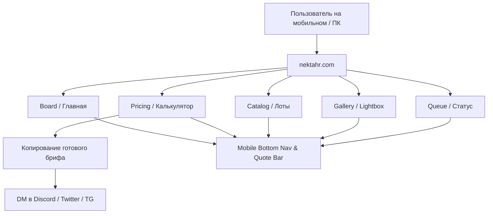

# NEK’TAHR / Сайт: передача контекста другому ИИ (AI HANDOFF)

> **Дата документа**: 31 октября 2026 г.  
> **Ревизия**: После масштабного мобильного редизайна (Mobile-First Overhaul, fixes on catalog, pricing & navigation)  
> **Репозиторий**: `SilvanDea/nektahr-hub` (ветка `main`)  
> **Продакшн адрес**: [https://nektahr.com/](https://nektahr.com/)  
> **Базовый коммит этапа**: `fb65c86` (и последующие коммиты документации)  

---

## Паспорт проекта и назначение документа

Этот документ предназначен для передачи полного контекста проекта новому инженеру или ИИ-ассистенту. Он содержит исчерпывающее техническое и концептуальное описание веб-ресурса **NEK’TAHR**: архитектуру, правила ценообразования, детали мобильного редизайна, устройство интерактивного калькулятора, структуру каталога, галереи и очереди, а также полный набор юридических документов (ToS, FAQ) и регламент публикации.



---

## Раздел 1. Продукт и аудитория

### 1.1. Персона и бренд художника
- **Имя / Псевдоним**: Nek’tahr (Nektahr).
- **Специализация**: Цифровой 2D-художник, специализирующийся на стилистике темного фэнтези (dark fantasy), динамичных антропоморфных/furry персонажах, выразительном дизайне оригинальных героев (OC), детальной проработке анатомии, одежды, оружия и магических эффектов.
- **Контент**: Создает как общедоступный контент (SFW), так и контент для взрослой аудитории (NSFW 18+), включая альтернативные версии, фута-вариации и пикантные ракурсы.
- **Целевая аудитория**: Международные заказчики (преимущественно США, Канада, Европа, Азия), коллекционеры адоптов (adoptables), заказчики индивидуальных артов (commissions), участники аукционов YCH (Your Character Here). Все общение и деловая документация ведутся на **английском языке**.

### 1.2. Контактная инфраструктура
| Канал | Идентификатор | Назначение |
|---|---|---|
| **Discord** | `@nektahr` | Основной канал прямой связи, прием заказов, согласование эскизов |
| **Twitter / X** | `@nektahr` | Публикация анонсов, WIP, витрина артов, личные сообщения |
| **Telegram** | `@nektahr` | Быстрая связь, альтернативный мессенджер |
| **Галереи** | FurAffinity, DeviantArt | Внешние портфолио и архивы |
| **Платежи** | PayPal, Ko-fi, Boosty / Stripe (по согласованию) | Прием оплаты в USD/EUR |

### 1.3. Миссия и роль сайта
Сайт **nektahr.com** выполняет роль автономного коммерческого хаба. Он устраняет необходимость вести переговоры с нуля в личных сообщениях благодаря следующим инструментам:
1. **Интерактивный Quote Builder**: клиент самостоятельно подбирает параметры, видит прозрачную цену и копирует готовый структурированный бриф для отправки в DM.
2. **Прозрачная очередь (Queue)**: статус заказов обновляется прямо на сайте, освобождая художника от рутинных ответов «на каком этапе мой арт?».
3. **Каталог готовых лотов (Catalog)**: актуальный статус доступности адоптов и YCH (Available / Reserved / Sold).
4. **Портфолио с интерактивным сравнением (Gallery)**: наглядная демонстрация качества от скетча до финального рендера и альтернативных версий.
5. **Юридическая защита (ToS & FAQ)**: строгий запрет на обучение AI / нейросетей, запрет NFT, четкие правила правок и условия возврата средств.

---

## Раздел 2. Страницы и пользовательские сценарии

Сайт состоит из 7 статических маршрутов, каждый из которых полностью оптимизирован под мобильные устройства и десктоп:

### 2.1. Главная (`/` или `index.html`) — Board
- **Hero-секция**: Приветственный заголовок, аватар, краткое позиционирование и бейдж доступности слотов (*Check Current Availability*).
- **Быстрая навигация**: 4 акцентные карточки верхнего уровня (Commission Pricing, Gallery Portfolio, Live Queue, Catalog & Adopts).
- **Highlights**: Карусель/сетка избранных свежих работ с фильтром по годам создания (2024–2025).
- **Direct Contacts**: Кнопки прямого перехода в Discord, Twitter, Telegram с микро-подсказками.

### 2.2. Прайс и калькулятор (`/pricing/`) — Pricing & Quote Builder
- **3-позиционный переключатель категорий**:
  - `Commissions`: кастомные заказы с нуля (по персонажам клиента).
  - `Adopts`: покупка готовых авторских дизайнов.
  - `YCH`: готовые позы и скетчи под персонажа покупателя.
- **Пакеты быстрого выбора (Quick Packages)**:
  - **Single ($200)**: Один персонаж + простой фон, полный рендер.
  - **Duo ($300)**: Два персонажа + простой фон, полный рендер.
  - **Custom / Epic ($500+)**: Многофигурные композиции, детальные фоны.
- **Степперы и опции**: выбор числа персонажей (1..5), детальности фона (None / Simple / Complex), модификаторов.
- **Тогглы модификаторов**: NSFW (+$50), Furry (+$50), Futa (+$25 при наличии NSFW, иначе +$50), Rush Order (+50%), NDA (+35%).
- **Кнопка «Copy Ready DM Request»**: мгновенно генерирует текстовый шаблон заявки и копирует его в буфер обмена с визуальным фидбеком (*Copied!*).

### 2.3. Каталог (`/catalog/`) — Adoptables & YCH Showcase
- **Фильтрация**: Быстрые чипы по категориям (`All`, `Adopts`, `YCH`) и статусам (`Available`, `Reserved`, `Sold`).
- **Карточки лотов**: Высококачественные превью, указание стартовой цены или тира, теги, кнопка подробного просмотра.
- **Мобильная пагинация**: Адаптивная центрированная полоса переключения страниц с touch-кнопками 40px. Исключены переломы строк.
- **Модалка лота**: Полное описание прав, включенных файлов, размер холста, форма быстрого бронирования.

### 2.4. Галерея (`/gallery/`) — Portfolio & Comparisons
- **Lightbox-просмотрщик**: Полноэкранный просмотр артов в высоком разрешении, поддержка свайпов, клавиш ESC, стрелок влево/вправо.
- **Интерактивный компаратор (Comparison Viewer)**: Возможность по клику переключаться между стадиями работы (Скетч → Лайн → Цвет → Рендер) и версиями (SFW → NSFW, Базовый костюм → Альтернативный).
- **NSFW-гейт**: Защитный экран 18+ с блюром превью до явного согласия пользователя.

### 2.5. Очередь (`/queue/`) — Live Progress Tracker
- **Колонки этапов**: Sketch / Concept, Line & Base Color, Final Render, Delivered / Archive.
- **Анонимизация**: Бережное отображение ников заказчиков (например, `Alex***`) без раскрытия приватных контактов.
- **Индикаторы дедлайнов**: Наглядные индикаторы активности и загруженности художника.

### 2.6. Правила (`/terms/`) — Terms of Service
- 15 детальных разделов, регулирующих финансовые, авторские и процедурные вопросы.
- Официальный источник истины — **английский язык**.

### 2.7. FAQ (`/faq/`) — Frequently Asked Questions
- 20 структурированных вопросов-ответов с интерактивными аккордеонами (`<details>` / `<summary>`).

---

## Раздел 3. Актуальные цены и калькулятор

Все расчеты на сайте строго детерминированы и согласованы с коммерческими правилами автора.

### 3.1. Тарифная сетка

#### А. Кастомные комиссии (Custom Commissions)
| Уровень рендера | Базовая цена (1 персонаж) | Каждый доп. персонаж | Сложный фон |
|---|---|---|---|
| **Clean Sketch** | $80 | +$60 | +$50 |
| **Color Sketch** | $120 | +$80 | +$60 |
| **Full Render** | $200 | +$100 | +$80 |

#### Б. Пакеты YCH (Your Character Here)
| Вариант YCH | Цена | Состав |
|---|---|---|
| **Sketch** | $30 | Черно-белый чистовой набросок на готовой позе |
| **Color Sketch** | $60 / $65 | Цветной скетч с базовыми тенями |
| **Full Render** | $120 | Полноценный рендер с эффектами освещения |
| **Autobuy (AB)** | $160 | Full Render + включенная 1 NSFW альтернатива |

#### В. Адопты (Adoptables Auction Tiers)
| Тир | Цена | Состав поставки |
|---|---|---|
| **Tier I (Base)** | $100 ($110 с оружием) | Полноростовой концепт персонажа без фона |
| **Tier II** | $200 | Full Render + 1 альтернативная версия на выбор покупателя |
| **Tier III** | $350 | Предыдущий тир + дополнительный бонусный арт персонажа |
| **Tier IV (AB)** | $500 | Предыдущий тир + полный Reference Sheet + крупные планы (close-ups) + PSD |

### 3.2. Модификаторы и надбавки
- **NDA (Конфиденциальность)**: **+35%** от общей суммы заказа. Арт не публикуется в соцсетях и портфолио автора.
- **Rush Order (Срочность)**: **+50%** от общей суммы заказа. Срок выполнения сокращается до 3–7 дней.
- **NSFW версия**: **+$50** к заказу.
- **Furry / Anthro адаптация**: **+$50** (или базовая интеграция).
- **Futa версия**: **+$25**, если уже выбрана или включена NSFW версия; **+$50**, если заказывается отдельно.
- **Коммерческая лицензия (Commercial Rights)**: оговаривается индивидуально (обычно +100%..+200% в зависимости от тиража).

### 3.3. Исправленный алгоритм расчета
В ходе предыдущих аудитов была ликвидирована скрытая ошибка вычитания `commissionBundle` (когда $200 + $50 ошибочно давало $240 вместо честных $250). Сейчас формула полностью прозрачна:
$$\text{Total} = \Big( (\text{Base} + \text{CharsFee} + \text{BgFee} + \text{VersionsFee}) \times (1 + \text{RushRate}) \Big) \times (1 + \text{NdaRate})$$

---

## Раздел 4. Галерея, каталог и NSFW

### 4.1. Механизм защиты и фильтрации 18+
- Контент с взрослыми сценами по умолчанию скрыт за размытием (`filter: blur(18px)`).
- Пользователь видит предупреждение о совершеннолетии.
- При клике «Мне есть 18 лет» состояние записывается в `localStorage.setItem('nsfw_warning_accepted', 'true')`.
- На панели навигации доступен мгновенный тоггл скрытия/показа NSFW контента.

### 4.2. Парные сравнения (Comparison Pairs)
В галерее и превью прайса реализована система парных сравнений:
- Каждая работа имеет привязку `compareFromBase` или явный массив `comparisonPairs`.
- Например: шаблон персонажа *Watermelon* сравнивается с версией в синем наряде; версия в синем наряде сравнивается со своей NSFW-вариацией.
- Это исключает некорректное сопоставление разнородных артов.

---

## Раздел 5. Дизайн, мобильный UX и согласованные предпочтения

### 5.1. Мобильная реформа: предпосылки и решения
В ходе масштабной переработки была решена ключевая проблема: ранее мобильная версия сайта была громоздкой, трудночитаемой и местами нефункциональной. Были реализованы следующие принципиальные улучшения:

1. **Фиксированный нижний док навигации (`.mobile-bottom-nav`)**:
   - Размещен внизу экрана на мобильных устройствах (`<= 860px`).
   - Поднят на `z-index: 100 !important;` с аппаратным ускорением `transform: translateZ(0)` — это предотвращает перекрытие элемента системными панелями браузеров Safari и Chrome.
   - Поддерживает безопасные зоны смартфонов: `padding-bottom: calc(8px + env(safe-area-inset-bottom, 0px))`.
   - Содержит 5 быстрых разделов: Board, Pricing, Gallery, Queue, Catalog.

2. **Двухъярусная плавающая панель цены (`.mobile-quote-bar`)**:
   - На странице `/pricing/` пристыкована строго над нижним меню: `bottom: calc(56px + var(--sab))` (`z-index: 99`).
   - Показывает текущую выбранную категорию (Commissions / Adopts / YCH), динамическую сумму и кнопку быстрого заказа.
   - **Интеллектуальный скролл-трекер**: Скрипт `assets/review-batch.js` через `IntersectionObserver` мягко скрывает плавающую панель цены, когда пользователь доскролливает до самого блока калькулятора (`.quote-panel`), исключая визуальный шум и дублирование кнопок.
   - Обеспечен достаточный нижний отступ контента (`padding-bottom: calc(144px + var(--sab))`), благодаря чему ни один элемент прайса не оказывается перекрыт.

3. **Исправление интерактивности карточек пакетов**:
   - В `src/app.js` исправлена ошибка: карточка *Two characters + simple background ($300)* не получала статус кликабельной из-за неверной проверки ключа. Добавлен ключ `'duo'` в массив `selectable`.
   - Теперь все 3 карточки пакетов активируются по тапу, переключают количество персонажей и подсвечиваются золотой рамкой `.quote-selected`.

4. **Исправление пагинации каталога**:
   - В `assets/catalog-queue.css` устранен баг `@media(max-width:600px){.catalog-pagination span{order:-1;width:100%}}`, из-за которого многоточие разрывало пагинатор на несколько неровных строк.
   - Пагинация теперь представляет собой аккуратный центрированный ряд с крупными кнопками 38–40px, а на экранах `< 480px` лишние двойные стрелки (`«` и `»`) скрываются.

5. **Тактильные зоны нажатия (Touch Targets >= 44–48px)**:
   - Все кнопки степперов (`+` и `−`), переключатели версий и категории увеличены до стандарта Apple Human Interface Guidelines / Material Design.
   - Добавлен мягкий тактильный отклик `:active { transform: scale(0.96); }`.

### 5.2. Цветовая палитра и стилистика
| Элемент | Цвет / Код | Описание |
|---|---|---|
| **Background Base** | `#0b0e14` | Глубокий обсидиановый темный фон |
| **Card Surface** | `#121620`, `#181e2b` | Карточки с тонкой каймой (`border: 1px solid rgba(255,255,255,0.07)`) |
| **Gold Accent** | `#e5a93c`, `#ffd166` | Фирменный золотой акцент (кнопки, активные вкладки, подсветка цен) |
| **Coral / NSFW** | `#e63946`, `#ff4d6d` | Акцент для 18+ контента и предупреждений |
| **Text Primary** | `#f8fafc` | Чистый контрастный текст заголовков и цен |
| **Text Muted** | `#94a3b8` | Второстепенные пояснения, подписи и подсказки |

---

## Раздел 6. Архитектура и карта кода

Проект построен как ультра-быстрый статический сайт с компиляцией через Python-скрипт и нулевой рантайм-зависимостью от тяжелых JS-фреймворков.

```
nektahr-hub/
├── index.html                   # Маршрут Board (главная страница)
├── pricing/index.html           # Маршрут Pricing (калькулятор)
├── catalog/index.html           # Маршрут Catalog (лоты)
├── gallery/index.html           # Маршрут Gallery (портфолио)
├── queue/index.html             # Маршрут Queue (доска заказов)
├── terms/index.html             # Маршрут Terms (условия ToS)
├── faq/index.html               # Маршрут FAQ (вопросы-ответы)
│
├── src/
│   ├── page.html                # Базовый HTML-шаблон для генератора
│   ├── app.js                   # Клиентская логика (калькулятор, фильтры, модалки)
│   ├── state.js                 # Инициализирующее состояние и данные лотов
│   ├── routes.json              # Метаданные 7 маршрутов (OG-теги, canonical, titles)
│   └── translations.js          # Словари локализации (EN, RU, ES)
│
├── assets/
│   ├── styles.css               # Основные глобальные стили сайта
│   ├── catalog-queue.css        # Стили каталога, пагинатора и очереди
│   ├── quote-builder.js         # Дополнительная логика интерактивного квотера
│   ├── review-batch.css         # Стили мобильного редизайна (dock, bar, targets)
│   ├── review-batch.js          # Логика мобильной навигации и IntersectionObserver
│   └── [media assets]           # Изображения артов, превью, аватары, иконки
│
├── scripts/
│   ├── build.py                 # Генератор статических страниц из src/
│   ├── package-site.py          # Сборка чистого релизного zip-архива
│   └── generate_handoff_docs.py # Генератор технической документации и PDF
│
├── tests/
│   ├── architecture-regression.py # Проверка маршрутов, метатегов, целостности
│   ├── validate-project.py        # Комплексная валидация ссылок, картинок, секретов
│   ├── runtime-regression.cjs     # 50 проверок логики калькулятора
│   ├── queue-regression.cjs       # 32 проверки контрактов очереди
│   ├── contact-regression.cjs     # 17 проверок ссылок и контактов
│   └── data-contracts.cjs         # Проверка связей артов, цен и переводов
│
├── docs/                        # Архитектурная документация, аудиты, гайды
└── package.json                 # Описание скриптов тестирования npm test
```

---

## Раздел 7. Сборка, публикация и работа с репозиторием

### 7.1. Пошаговый цикл разработки
При внесении любых изменений необходимо строго следовать регламенту:

1. **Внесение правок в исходники (`src/`, `assets/`)**.
2. **Сборка статических страниц**:
   ```powershell
   py -3 scripts/build.py
   ```
   *Скрипт компилирует все 7 маршрутов, внедряет актуальные хеши стилей и проверяет целостность.*
3. **Запуск тестового комплекса**:
   ```powershell
   $env:PATH = "C:\Users\DrinTrava\AppData\Local\Programs\Python\Python313;C:\Program Files\nodejs;C:\Program Files\Git\cmd;" + $env:PATH
   npm test
   ```
   *Все 6 тестовых сюит (102 проверки) должны завершиться со статусом passed.*
4. **Упаковка релизного дистрибутива** (при необходимости):
   ```powershell
   py -3 scripts/package-site.py
   ```
5. **Коммит и публикация в Git**:
   ```powershell
   git add .
   git commit -m "feat: description of changes"
   git push origin main
   ```
6. **Автоматический деплой**:
   После пуша в ветку `main` GitHub Actions запускает пайплайн публикации на GitHub Pages. Изменения вступают в силу на [https://nektahr.com/](https://nektahr.com/) в течение 1–2 минут.

---

## Раздел 8. Данные очереди, аудит, мобильная оптимизация и ограничения

### 8.1. Контроль качества и результаты тестов
Текущее состояние кодовой базы подтверждено полным прохождением всех автоматических тестов:
- `architecture-regression.py`: 7 статических маршрутов, контент-хеши, метаданные, английский базовый контент, синтаксис JS, страница 404 — **PASSED**.
- `validate-project.py`: 364 локальные HTML-ссылки, 131 декодированное изображение, 68 элементов каталога, 87 записей артов, отсутствие секретов в коде — **PASSED**.
- `runtime-regression.cjs`: 50 проверок логики калькулятора (включая проверку пакетов Single/Duo, отсутствие скрытых вычетов, точность NDA +35%) — **PASSED**.
- `queue-regression.cjs`: 32 проверки отказоустойчивости очереди при сетевых сбоях — **PASSED**.
- `contact-regression.cjs`: 17 проверок работоспособности всех контактных ссылок — **PASSED**.
- `data-contracts.cjs`: 87 артов, 68 позиций каталога, 105 медиа-ссылок, 3 языка — **PASSED**.

### 8.2. Архитектурные ограничения
1. **Отсутствие серверной БД**: сайт не имеет бэкенда на Node.js/Python в рантайме. Все данные каталога и очереди хранятся в статических структурах `src/state.js` и JSON. Это обеспечивает максимальную скорость (TTFB < 50ms), бесплатный хостинг и абсолютную безопасность от взлома базы данных.
2. **Оформление заказов через DM**: на сайте нет корзины с онлайн-эквайрингом банковских карт. Все заказы формируются через кнопку генерации текста брифа и передаются напрямую художнику в личные сообщения для индивидуального согласования.

---

## Раздел 9. Инструкция следующему ИИ

Если вы — искусственный интеллект, получивший задачу по доработке сайта **NEK’TAHR**, следуйте этим строгим правилам:

1. **Не изменяйте ToS и юридические условия**: Текст условий обслуживания (Terms of Service) и правила цен выверены с художником. Любые изменения в них допустимы **только** по прямому требованию пользователя.
2. **Английский язык — эталон**: Все базовые тексты, ключи и термины в `src/` пишутся на английском языке. Русская и испанская локализации являются вторичными.
3. **Всегда пересобирайте проект**: Никогда не редактируйте `index.html` или другие сгенерированные файлы в корне вручную. Редактируйте `src/page.html`, `src/app.js`, `src/translations.js` или стили в `assets/`, после чего **обязательно запускайте `py -3 scripts/build.py`**.
4. **Запускайте тесты**: Ни один коммит не должен отправляться в репозиторий без прохождения `npm test`.
5. **Сохраняйте мобильную адаптивность**: Проверяйте, чтобы новые кнопки имели размер не менее 44px, а нижний навигационный док и бар стоимости не перекрывали важный контент.

---

## Приложение A. Действующий EN ToS (Официальный текст)

### SECTION 01 · PAYMENT & REFUNDS · Payment Methods, Holds & Refund Policy
- Prices are in USD; EUR can be agreed before payment. Custom commissions and YCH: PayPal or Ko-fi. Adopts: PayPal, Ko-fi or DeviantArt, subject to the listing and confirmed payment method.
- Payment is due within 48 hours after the order or winning bid is confirmed. Contact me before payment if you need a different arrangement.
- A free hold lasts 48 hours. Paid holds start at 7 days; longer terms can be agreed. The advance is at least $10 and is credited toward the purchase. The remaining balance is due before the hold expires; otherwise, the hold ends and the item may be offered again. An auction listing may be reserved only if it remains unsold after bidding ends and has been listed for more than 14 days. Confirming a reservation closes the listing to new offers. For YCH, the slot is released while the template remains available for repeat orders.
- Full payment is required by default. For orders over $200, instalments can be agreed in advance; exceptions for smaller orders may be agreed individually. The deposit, dates and work start are confirmed before payment. Final files follow full payment.
- All payments are non-refundable, including payments for commissions, YCH, adopts and reservation advances. Any exception is entirely at my discretion and must be explicitly agreed by me.
- Any species, gender or body type can be discussed for a YCH; changes must fit the template and are agreed first. Sketch $30, color sketch $65, full render $120, AB $160 with one NSFW version. An extra outfit is $50. The template accepts repeat orders.

### SECTION 02 · WORKFLOW & DEADLINES · Process Stages, WIPs & Turnaround Time
- Custom commissions: the main pose, composition and design are approved at the sketch stage. Later stages allow smaller changes; reworking an approved stage may cost extra. A custom adopt is a custom commission.
- YCH: your character is drawn using the shown pose and composition. Changes are agreed before payment and depend on the template. A new pose or substantial redraw is quoted separately. Approval stages depend on the chosen finish; templates accept repeat orders.
- Ready-made adopts: you buy the displayed design and the files included in the selected tier. There is no new sketch approval for an already finished base. Additional artwork and versions have their own agreed scope and approval stages.
- If I need your approval or more information, work may pause until you reply and the estimated delivery date may move. References guide the result, which is drawn in my style; they are not a promise to copy another artist’s work.
- Your agreed delivery estimate specifies waiting time and production time. Ready-made adopt files follow full payment; unfinished tier bonuses and later additions have separate estimates. Download and back up your files as soon as you receive them. I do not guarantee file storage, continued availability of download links or replacement copies. Keeping your files safe is your responsibility.

### SECTION 03 · REVISIONS & EDITS · Corrections During Each Stage
- My mistakes against the agreed brief are corrected free and do not count toward revisions. Normally 3–5 revisions are included at each available approval stage. I determine the scope and whether a change fits that stage; any extra fee is agreed before editing.
- Additional minor edits beyond the included revisions cost $10 each. Medium changes and major redraws are quoted before work begins. Fixing my mistakes remains free.
- An additional facial expression costs $25; other alternative versions cost $50 (futa $25 with an existing NSFW base).

### SECTION 04 · COPYRIGHT, USAGE & NDA · Personal Rights, Commercial License & Privacy
- I retain authorship and portfolio rights to all artwork I create (posting low-res watermarked versions on DeviantArt, FurAffinity, Pixiv, or X).
- Personal Use (Included): You may use the art for personal avatars, banners, character profiles (Toyhouse), and printing for yourself. Please credit @Nektahr_ when sharing.
- Private / NDA Orders (+35%): If you wish the artwork to remain completely private and never be posted to my public galleries, a +35% NDA fee applies.
- Personal avatars, profile posts and prints for yourself are personal use. Selling prints or merchandise, advertising, and using artwork in a paid product require a separate commercial agreement; the price is agreed individually.

### SECTION 05 · ADOPTABLE & DESIGN RULES · Ownership, Redesigns & Resale Policy
- The base adopt purchase includes finished files without sales text or watermarks. You may freely choose or change the character’s name, story, personality and other non-visual information when ordering or afterwards. This does not permit changing the visual design. Keep the original design credit; commercial use requires a separate agreement.
- Higher tiers include the previous ones. $200: full render, one alt version and one extra expression. $300: one bonus color sketch, framing of your choice up to three-quarter, one character and a simple background. $450: front/back reference sheet, palette and two close-ups; the front view uses existing artwork. Three extra expressions in total and NSFW are included at Tier IV.
- You may resell the adopt for the same price you paid or less. Notify me of the transfer; keep the design credit. Gifting and trading are allowed.
- Design credit must always remain with Nek'tahr (@nektahr).
- PSD files are available on request only for adoptables at Tier IV. PSD files are not offered separately for commissions or YCH.

### SECTION 06 · STRICT AI & NFT PROHIBITION · Zero Tolerance for AI Training & Crypto
- You may NOT under any circumstances feed my sketches, lineart, adoptables, or finished illustrations into AI image generators, LoRA training, or machine learning datasets.
- You may NOT mint any of my artworks or character designs as NFTs or use them in blockchain/crypto projects.

### LANGUAGE · EN / RU / ES · English is the reference version
- These terms are written in English. Translations are provided for convenience. If wording differs or there is a dispute about interpretation, the English version applies.

---

## Приложение B. Действующий EN FAQ (Официальный текст)

#### Q1: What should I send when asking about an order?
> Send the YCH/adopt link or your custom commission idea, character references and important wishes. With several references, explain which details to use or ignore. You can leave decisions to me if you prefer artistic freedom.

#### Q2: Can you design a character from a written description?
> For commissions and YCH at Full Render or AB: simple development with clear guidance is +30% (minimum $30 per character); detailed development is +50% (minimum $70). The percentage uses the selected base price, excluding extras. The category is agreed before payment; development already included in a quote is not charged twice. Other cases are unavailable by default or discussed individually. Custom adopts are commissions.

#### Q3: What payment methods and currencies do you accept?
> Prices are in USD; EUR can be agreed before payment. Custom commissions and YCH: PayPal or Ko-fi. Adopts: PayPal, Ko-fi or DeviantArt, subject to the listing and confirmed payment method. Payment is due within 48 hours after the order or winning bid is confirmed. Contact me before payment if you need a different arrangement.

#### Q4: Do you offer payment plans (installments) for higher tiers or AB?
> Full payment is required by default. For orders over $200, instalments can be agreed in advance; exceptions for smaller orders may be agreed individually. The deposit, dates and work start are confirmed before payment. Final files follow full payment.

#### Q5: How do Adoptable Stretch Goal Tiers work if there is no sample image yet?
> Higher tiers include the previous ones. $200: full render, one alt version and one extra expression. $300: one bonus color sketch, framing of your choice up to three-quarter, one character and a simple background. $450: front/back reference sheet, palette and two close-ups; the front view uses existing artwork. Three extra expressions in total and NSFW are included at Tier IV.

#### Q6: Where do Adoptable & YCH auctions take place, and when do they end?
> Auctions are announced on the relevant platform. Check my profile or message me to confirm its status and closing time. An active auction cannot be reserved. An unsold listing may be reserved after bidding ends and it has been listed for more than 14 days. Paid holds start at 7 days, with longer terms by agreement, and require an advance of at least $10 credited toward the price. A confirmed reservation closes it to new offers. The winning bidder has 48 hours to pay after confirmation.

#### Q7: Can I change the gender, body type, or species on a YCH slot?
> Minor adjustments to body type, ears/tails (kemonomimi), horns, wings, and expressions are always welcome on YCH slots! If a YCH requires a complete anatomical rebuild, I will let you know in DMs if a small adjustment fee applies.

#### Q8: Where do I ask about progress?
> The main contact is the platform where you placed the order. For a faster response, contact me on Discord and include your original platform username and order number or artwork title. Queue shows an approximate stage and estimated date; message me for details or a WIP.

#### Q9: How are files delivered?
> Original files are delivered by a download link or another agreed method. Ready-made adopt files can be delivered before commissioned additions. Formats and resolution are confirmed before ordering. PSD is available on request only for adopts at Tier IV. Download and back up your files as soon as you receive them. I do not guarantee file storage, continued availability of download links or replacement copies. Keeping your files safe is your responsibility.

#### Q10: Can I keep my commission private (NDA) or use it for streaming / VTubing?
> Yes. A private / NDA request adds 35%. Commercial use requires a separate agreement and a separately quoted fee.

#### Q11: How do I check current availability?
> Please contact me directly to check availability or ask about a waitlist. The website does not publish live slot counts.

#### Q12: Can I change an adopt’s name or story?
> Yes. Clean files without sales text or watermarks are included in the base purchase. You may freely change the name, story, personality and other non-visual information when ordering or later. This permission does not cover changing the visual design.

#### Q13: Can I buy a character shown on a YCH template?
> Sometimes, if it is my available original design. Send the example so I can confirm. Existing fanart or another owner’s character is not offered as my adopt. A custom adopt is ordered as a commission.

#### Q14: Can I order additions after delivery?
> You can ask about outfits, expressions or other versions later. Availability, price and delivery time are agreed separately.

#### Q15: Can I post the artwork?
> You may post your purchased artwork on your profiles with artist credit and use it personally under the ToS. Commercial use requires a separate agreement.

#### Q16: Can I ask for BDSM or fetish art?
> Yes, I draw BDSM and other fetish themes. Feel free to ask about any ideas or preferences — we’ll discuss the details and whether I can take the request.

#### Q17: Can I get a refund?
> All payments are non-refundable, including payments for commissions, YCH, adopts and reservation advances. Any exception is entirely at my discretion and must be explicitly agreed by me.

---

## Приложение C. Контрольный чеклист перед сдачей

| Проверка | Статус | Комментарий |
|---|---|---|
| **Сборка static pages** | ОК | 12 файлов синхронизированы без расхождений |
| **Тесты npm test** | ОК | 6 наборов тестов, 102 проверки пройдены |
| **Мобильный Bottom Nav** | ОК | Закреплен на `z-index: 100`, safe-area-inset учтен |
| **Пакеты Single / Duo** | ОК | Обе карточки интерактивны, переключают 1 / 2 персонажей |
| **Калькулятор цен** | ОК | $200 Single, $300 Duo, $250 Full+NSFW, NDA +35% |
| **Пагинатор каталога** | ОК | Центрирован, убран перелом строк от эллипсиса |
| **Очередь заказов** | ОК | Защита от сбоев, корректные статусы |
| **Публикация** | ОК | GitHub Actions развернут на `https://nektahr.com/` |